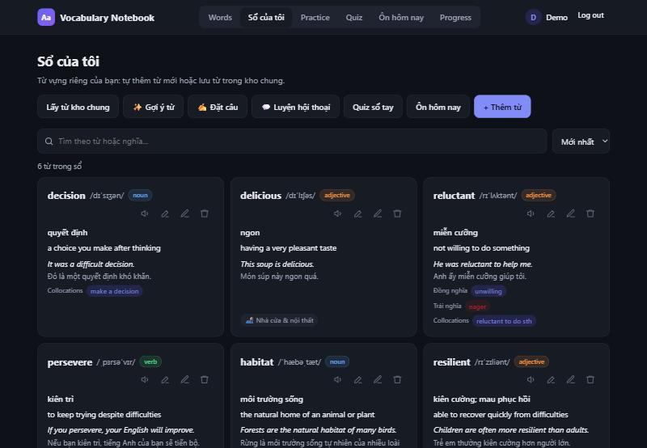
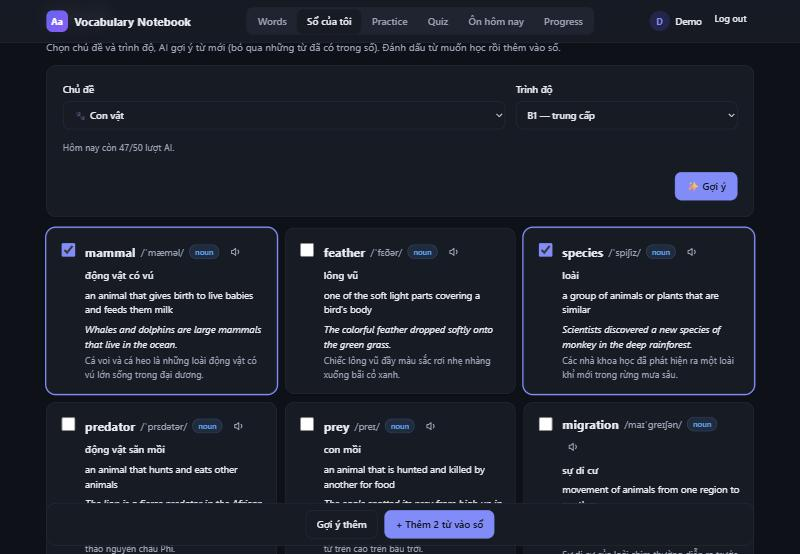
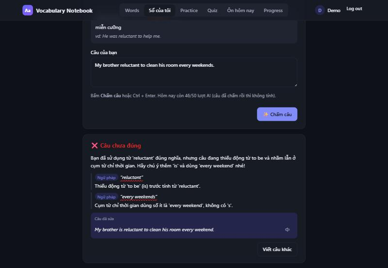
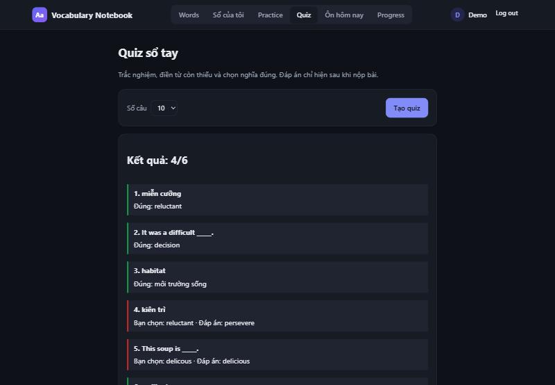
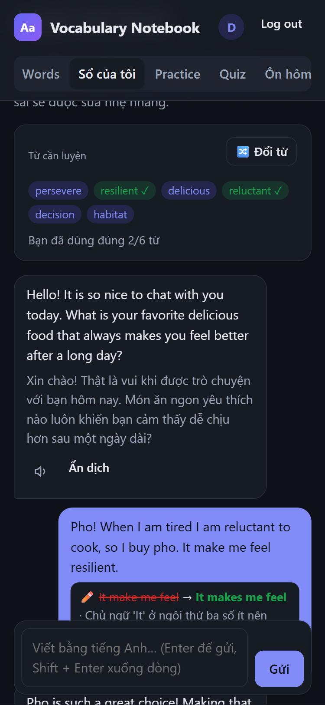

# Vocabulary Notebook (EN–VN)

Sổ tay từ vựng Anh–Việt có AI: mỗi người có một sổ riêng, AI điền thông tin từ, gợi ý từ mới, chấm câu tự đặt và trò chuyện để luyện từ; ôn tập bằng quiz và lặp lại ngắt quãng (SM-2).

Web đang chạy: **https://vocab-notebook-exdz.onrender.com**



## Tính năng

| Tính năng | Trang | Mô tả |
|---|---|---|
| Kho từ chung | `#/` | Hơn 1300 từ theo 14 chủ đề, tìm kiếm, lọc loại từ, nghe phát âm; bấm 🔖 để lưu vào sổ riêng |
| Sổ của tôi | `#/notebook` | Sổ riêng của mỗi người: IPA, định nghĩa tiếng Anh, ví dụ có dịch, đồng nghĩa, trái nghĩa, collocations, chủ đề |
| ✨ AI điền | `#/notebook/new` | Gõ một từ, AI điền nghĩa, IPA, ví dụ… để xem lại trước khi lưu; gợi ý khi gõ sai chính tả |
| ✨ Gợi ý từ | `#/notebook/suggest` | Chọn chủ đề + trình độ A1–C1, AI gợi ý khoảng 10 từ mới (bỏ qua từ đã có trong sổ), đánh dấu từ muốn thêm |
| ✍️ Đặt câu | `#/notebook/sentence` | Tự đặt câu với một từ trong sổ; AI chấm, giải thích lỗi bằng tiếng Việt, đưa câu đã sửa và câu hay hơn |
| 💬 Luyện hội thoại | `#/notebook/chat` | Trò chuyện tiếng Anh với AI; AI dùng từ trong sổ, sửa lỗi nhẹ nhàng và đánh dấu ✓ từ bạn đã dùng đúng |
| Quiz | `#/quiz` | Trắc nghiệm, điền từ, chọn nghĩa từ sổ riêng; chấm điểm ở server, đáp án chỉ trả về sau khi nộp |
| Ôn hôm nay | `#/srs` | Lặp lại ngắt quãng SM-2 theo giờ Việt Nam; từ hay quên (mức 0–2) được AI tạo mẹo ghi nhớ |
| Practice | `#/review` | Ôn kho chung: gõ đáp án Anh → Việt hoặc Việt → Anh, theo chủ đề |
| Progress | `#/progress` | Tiến độ ôn tập của chính mình |
| Admin | `#/admin` | Thêm / sửa / xoá từ trong kho chung, Import / Export CSV, xem tiến độ learner |

Giao diện dùng được trên điện thoại (menu cuộn ngang, nút không xuống dòng).

## Ảnh chụp màn hình

| Gợi ý từ theo chủ đề + trình độ | AI chấm câu tự đặt |
|---|---|
|  |  |
| **Quiz sổ tay** | **Luyện hội thoại (điện thoại)** |
|  |  |

## Stack

- Backend: Python 3.12 / FastAPI, giao diện HTML + JavaScript thuần (`app/static/`)
- Database: PostgreSQL (Supabase ở production, container Postgres khi chạy local); migration SQL trong `migrations/`
- AI: Gemini API qua SDK `google-genai`, chỉ gọi từ server
- Deploy: Render (Docker, HTTPS)
- CI/CD: GitHub Actions (Ruff, pytest, Docker build, Gitleaks)

## AI

- Một lớp AI duy nhất: `AIService` + `GeminiProvider` trong `app/ai/`; đổi nhà cung cấp chỉ sửa một chỗ. Prompt nằm riêng trong `prompts/*.md` (có `version`; đổi prompt thì tăng version để cache cũ được làm lại).
- Gemini trả JSON theo schema (`app/ai/schemas.py`), server validate lại. JSON sai hoặc thiếu thì hỏi lại 1 lần; lỗi 429 thì thử lại có backoff rồi báo "The AI service is busy. Please try again in a few minutes."
- Bảo mật: `GEMINI_API_KEY` chỉ nằm ở server; nội dung người dùng gửi (câu, tin nhắn) được đưa vào prompt như dữ liệu, không phải lệnh.
- Mỗi người bị giới hạn lượt AI (mặc định 5 lượt/phút, 50 lượt/ngày); lỗi AI không bị trừ lượt. Kết quả dùng chung được cache trong bảng `ai_cache`: tra lại từ đã có người tra, chấm lại câu đã chấm thì không tốn lượt.

| Endpoint | Dùng cho | Cache |
|---|---|---|
| `GET /api/ai/status` | AI có bật không, model, số lượt còn lại | – |
| `POST /api/ai/lookup` | ✨ AI điền thông tin một từ | theo từ |
| `POST /api/ai/suggest-words` | ✨ Gợi ý từ theo chủ đề + trình độ | lần gợi ý đầu của mỗi chủ đề + trình độ |
| `POST /api/ai/check-sentence` | ✍️ Chấm câu tự đặt | theo từ + câu |
| `POST /api/ai/chat` | 💬 Luyện hội thoại (trình duyệt giữ hội thoại, server không lưu) | không |
| `POST /api/srs/words/{id}/mnemonic` | Mẹo ghi nhớ cho từ hay quên | theo từ + nghĩa |

Mọi endpoint AI yêu cầu đăng nhập. Không có `GEMINI_API_KEY` thì các nút AI bị tắt, phần còn lại của app vẫn chạy.

## Tài khoản, vai trò & đăng nhập

- Hai vai trò (`users.role`):
  - **learner** (mặc định khi đăng ký): sổ riêng, ôn tập, xem tiến độ của chính mình ở trang `#/progress`; lịch sử ôn tập là của riêng mỗi người.
  - **admin**: thêm / sửa / xoá từ trong **kho từ chung** mà mọi learner cùng học, xem tiến độ learner ở trang `#/admin`. API thêm/sửa/xoá từ trả `403` nếu không phải admin.
- **Không ai tự đăng ký được admin**: đăng ký luôn tạo learner. Trang đăng nhập có ô nhỏ **Admin** mở form đăng nhập riêng (`#/admin-login`); server từ chối (`403`, không tạo session) mọi tài khoản không phải admin đăng nhập ở đó.
- **Tạo tài khoản admin**: đặt `ADMIN_EMAIL` và `ADMIN_PASSWORD` (≥ 8 ký tự). Mỗi lần container khởi động, `python -m app.migrate` tạo tài khoản đó với vai trò admin, hoặc nâng tài khoản đã có email đó lên admin và đặt lại mật khẩu theo `ADMIN_PASSWORD`.
  - Render: Dashboard → service → **Environment** → thêm 2 biến, rồi deploy lại.
  - Local: thêm 2 dòng `ADMIN_EMAIL=...` và `ADMIN_PASSWORD=...` vào `.env`, rồi `docker compose up --build`.
- Mật khẩu băm bằng `scrypt` (salt ngẫu nhiên, `app/security.py`); DB không lưu mật khẩu gốc.
- Đăng nhập tạo session: trình duyệt giữ token ngẫu nhiên trong cookie `HttpOnly`, `SameSite=Lax` (`Secure` khi `APP_ENV=production`); DB chỉ lưu SHA-256 của token, hết hạn sau 30 ngày. Đăng xuất xoá session trên server.
- API: `POST /api/auth/register`, `POST /api/auth/login`, `POST /api/auth/logout`, `GET /api/auth/me`, `GET /api/me/progress`, `GET /api/admin/users` (admin). Mọi route `/api/...` trả `401` nếu chưa đăng nhập.

## Thêm nhiều từ: Import / Export CSV (admin)

- Trang Admin có **Import CSV**: chọn file → web kiểm tra và hiện bản xem trước (bao nhiêu từ mới, bao nhiêu từ đã có, dòng nào lỗi) → bấm **Import** mới lưu. File còn dòng lỗi thì không lưu được. Tuỳ chọn ghi đè từ đã có.
- **Export CSV** tải toàn bộ kho từ cùng định dạng, mở được bằng Excel (UTF-8), sửa xong import lại.
- Định dạng: `word,meaning_vi,part_of_speech,example,usage_note,topic` (chỉ `word` và `meaning_vi` bắt buộc); file mẫu ở `/static/words-template.csv`. API: `POST /api/admin/import` (`dry_run` = chỉ kiểm tra), `GET /api/admin/words.csv`.
- **1000 từ có sẵn**: `data/ngsl_1000.csv`, dựng từ NGSL + Wiktionary tiếng Việt + Tatoeba bằng `scripts/build_wordlist.py`, nghĩa đã được soát lại; `scripts/ai_enrich.py` dùng Gemini để điền ô trống hoặc gợi ý từ mới theo chủ đề. Nguồn, giấy phép và cách làm: [data/README.md](data/README.md).

## Chạy local (Docker)

Cần Docker Desktop. Một lệnh dựng cả app và PostgreSQL:

```bash
cp .env.example .env
docker compose up --build
```

Mở http://localhost:8000, đăng ký tài khoản rồi vào **Sổ của tôi**. Migration tự chạy khi container app khởi động. Muốn dùng AI thì điền key Gemini của riêng bạn vào `.env` (`GEMINI_API_KEY=...`, lấy miễn phí tại https://aistudio.google.com/apikey) rồi khởi động lại. API docs ở `/docs`.

Dừng: `docker compose down` (giữ dữ liệu) hoặc `docker compose down -v` (xoá luôn dữ liệu).

## Chạy test

```bash
pip install -r requirements-dev.txt
ruff check . && pytest
```

Test không cần database và không cần key: dùng repository giả (`tests/fake_repo.py`) và AI giả trả lời theo hàng đợi (`tests/fake_ai.py`).

## CI/CD và bảo mật

- Mỗi pull request chạy Ruff, pytest, Docker build và Gitleaks trên toàn bộ lịch sử Git (`.github/workflows/ci.yml`). Một job thất bại chỉ chặn được việc merge khi `main` đã bật branch protection với hai status check bên dưới.
- Sau khi các job trên thành công khi merge vào `main`, GitHub Actions gọi Render Deploy Hook nếu repository có secret `RENDER_DEPLOY_HOOK_URL` (Settings → Secrets and variables → Actions; URL lấy ở Render → service → Settings → Deploy Hook). Chưa có secret thì bước deploy được bỏ qua và Render tự deploy (`autoDeploy: true`). Chỉ đổi `autoDeploy: false` trong `render.yaml` **sau khi** đã thêm secret, để không deploy hai lần.
- Cần bật branch protection cho `main` (chủ repo làm) (GitHub → Settings → Branches → Add branch protection rule): yêu cầu pull request, ít nhất 1 approval, các status check `Scan Git history` và `Lint, test, and build`; chặn force-push và xoá nhánh.
- Không commit `.env`, key hay connection string; cấu hình đọc từ biến môi trường.

## Deploy lên Render

Render build từ `Dockerfile` và cấp HTTPS (`https://<tên-service>.onrender.com`).

1. Render Dashboard → **New → Blueprint** → chọn repo này. Render đọc `render.yaml` và tạo web service `vocab-notebook` (Docker, free, Singapore, health check `/health`).
2. Khi được hỏi, nhập biến môi trường bí mật:
   - `DATABASE_URL`: connection string của Supabase (Project Settings → Database → Connection string, chế độ *Transaction pooler*, cổng 6543). Thêm `?sslmode=require` ở cuối nếu chưa có.
   - `ADMIN_EMAIL` và `ADMIN_PASSWORD`: tài khoản admin.
   - `GEMINI_API_KEY`: key Gemini để bật AI (đúng chính tả, không dấu cách). Thêm sau thì bấm **Save, rebuild, and deploy**.
3. `APP_ENV=production` và `GEMINI_MODEL` đã khai báo sẵn trong `render.yaml`.
4. Mỗi lần merge vào `main`, Render tự build và deploy lại (hoặc qua Deploy Hook, xem phần CI/CD). Container chạy `python -m app.migrate` trước khi khởi động nên schema luôn được cập nhật.

Kiểm tra sau deploy: `/health` → `{"status":"ok"}`, `/health/db` → `{"db":"ok", ...}`, `/api/info` → `"env": "production"`. AI đã bật khi nút **✨ AI điền** (Sổ của tôi → + Thêm từ) bấm được.

Biến môi trường:

| Biến | Bắt buộc | Ý nghĩa | Mặc định |
|---|---|---|---|
| `DATABASE_URL` | có | Chuỗi kết nối PostgreSQL | |
| `APP_ENV` | không | `development` / `production`, hiện ở `/api/info`; `production` bật cookie `Secure` | `development` |
| `PORT` | không | Render tự đặt | `8000` |
| `ADMIN_EMAIL` | không | Email tài khoản admin, tạo / nâng quyền khi khởi động | |
| `ADMIN_PASSWORD` | không | Mật khẩu admin (≥ 8 ký tự); là secret, không commit | |
| `GEMINI_API_KEY` | không | Key Gemini, chỉ nằm ở server. Không có thì AI tắt, app vẫn chạy | |
| `GEMINI_MODEL` | không | Tên model, đổi không cần sửa code | `gemini-3.5-flash-lite` |
| `GEMINI_TIMEOUT` | không | Số giây chờ Gemini trả lời một lần | `20` |
| `AI_LIMIT_PER_MINUTE` / `AI_LIMIT_PER_DAY` | không | Giới hạn lượt AI mỗi người | `5` / `50` |

## Quy tắc làm việc

- Không commit thẳng vào `main`: mọi thay đổi đi qua pull request và phải có người khác review.
- Migration chỉ được thêm file mới, không sửa hay xoá file cũ: Render tự chạy chúng lên database thật mỗi lần deploy.
- Không commit `.env`, key hay connection string. Mỗi người tự tạo key Gemini riêng, không dán key vào nhóm chat.
